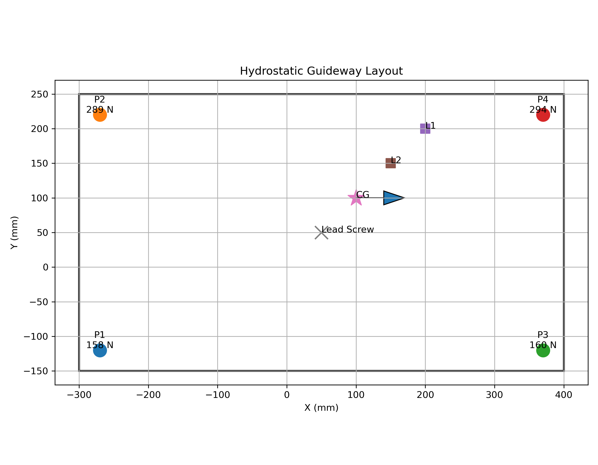
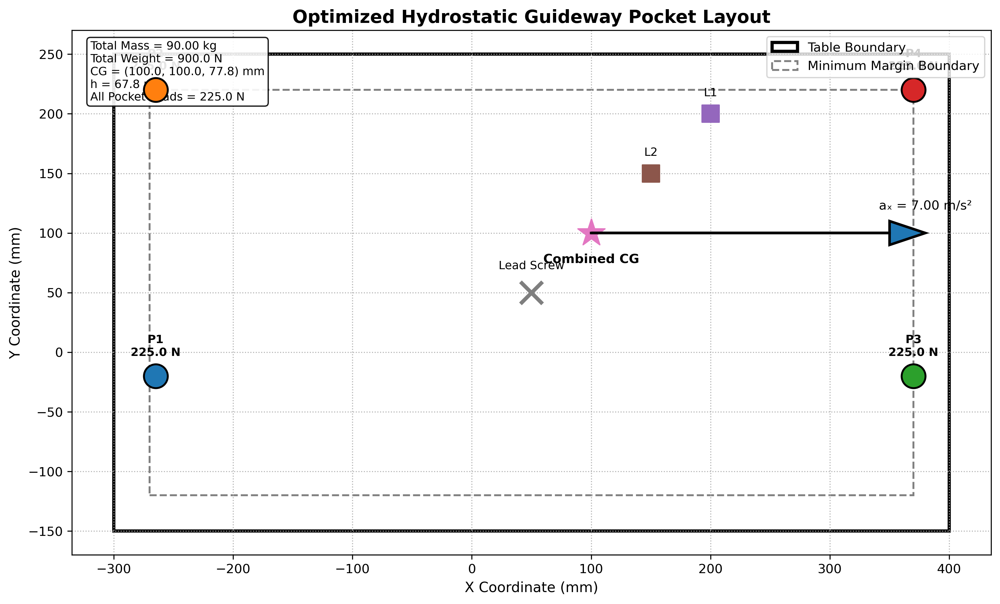

# Hydrostatic Guideway Pocket Toolbox

Python tools for a machine-tool table supported on **four hydrostatic bearing pockets** arranged in a rectangle.

| Notebook | What it does |
|---|---|
| `01_pocket_load_estimator` | Estimates the reaction force on each of the four pockets under self-weight, external loads and single-axis acceleration |
| `02_pocket_position_optimizer` | Finds pocket positions that give equal load sharing, so the maximum pocket load is minimized |

Units: lengths in mm, mass in kg, acceleration in m/s², forces in N.

## Method

Combined centre of gravity of the table and all external loads:

$$X=\frac{\sum m_i x_i}{\sum m_i},\quad Y=\frac{\sum m_i y_i}{\sum m_i},\quad Z=\frac{\sum m_i z_i}{\sum m_i}$$

Total weight $W = Mg$, where $M = \sum m_i$.

The lead screw force acts below the CG, so acceleration produces an overturning moment

$$M_o = M\,a\,h, \qquad h = Z - z_{ls}$$

### Load estimator

Pockets are numbered P1 (back, right), P2 (back, left), P3 (front, right), P4 (front, left), where back/front are the low/high x sides and right/left are the low/high y sides. Let $b, f$ be the x-distances from the CG to the back and front pocket rows, $r, l$ the y-distances to the right and left rows, and $L_x, L_y$ the pocket spans.

Static case: each pocket load is proportional to the CG's distance from the *opposite* pockets, e.g.

$$N_1 = W\,\frac{f\,l}{L_x L_y}$$

With acceleration along x, $W f$ and $W b$ are replaced by $W f + M_o$ and $W b - M_o$ (and likewise along y). Four unknown reactions with only three equilibrium equations make the problem statically indeterminate, so sharing perpendicular to the acceleration is taken proportional to the CG's distances from the pocket rows.

### Position optimizer

1. Start with all pockets at the minimum permitted margin from the table edges (always forming a rectangle).
2. **Static:** keep the pocket pair nearest the CG fixed and move the opposite pair until all four reactions are equal.
3. **Uni-directional acceleration:** keep the row carrying the larger normal force fixed and move the opposite row towards the CG until the load is shared equally.
4. Recompute pocket coordinates and support spans, then plot the layout.

## Assumptions

- The table is a perfectly rigid body and all pockets are identical.
- Pocket reactions are concentrated, vertical, compressive forces.
- Inertial effects are treated as equivalent static forces.
- Only static loading or acceleration in one direction at a time is considered.

## Limitations

- Fluid film stiffness, pocket pressure distribution and restrictor characteristics are neglected.
- Structural deformation of the table and squeeze-film effects are neglected.
- Simultaneous acceleration in x and y is not supported (the reactions cannot be uniquely determined with this model).

## Example

Inputs: table 700 × 400 × 70 mm, pocket margins 30 mm, table 50 kg with CG at (50, 50, 70), lead screw at (50, 50, 10), $a_x = 7$ m/s², $g = 10$ m/s², and two external loads:

| Load | Mass (kg) | Position (mm) |
|---|---|---|
| 1 | 10 | (200, 200, 80) |
| 2 | 30 | (150, 150, 90) |

Combined CG = (100, 100, 77.78) mm, total weight 900 N.

**Load estimator** (pockets at minimum margin)

| Pocket | N1 | N2 | N3 | N4 |
|---|---|---|---|---|
| Reaction (N) | 157.56 | 288.85 | 160.09 | 293.50 |

**Optimizer** (equal sharing): every pocket carries 225 N. Optimized pockets are at x = −264.89 and x = 370.00 mm, and y = −20 and y = 220 mm, giving spans of 634.89 mm × 240 mm.




## Usage

```bash
pip install matplotlib jupyter
jupyter notebook
```

Open a notebook, run the cells, and enter the inputs when prompted.
